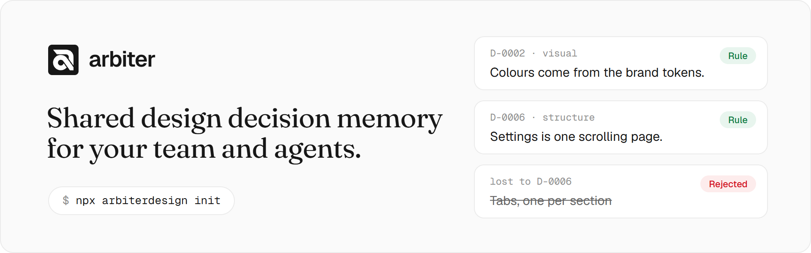
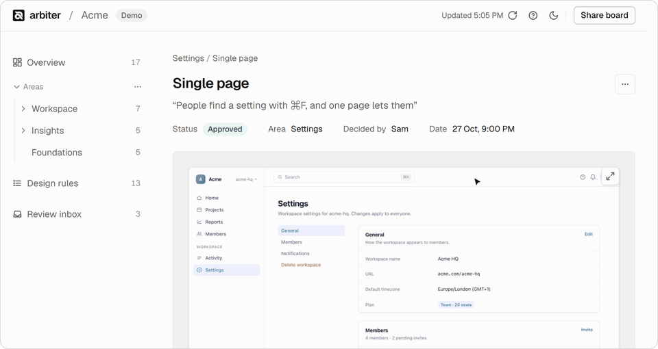
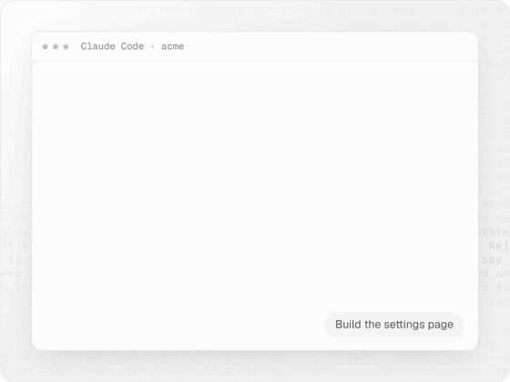
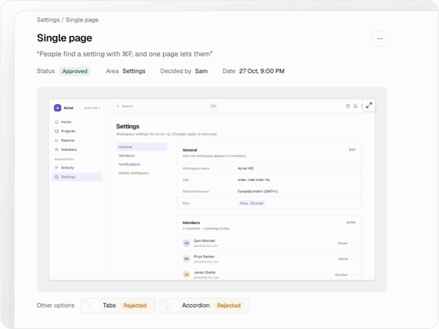
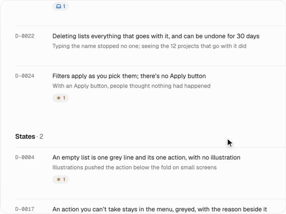
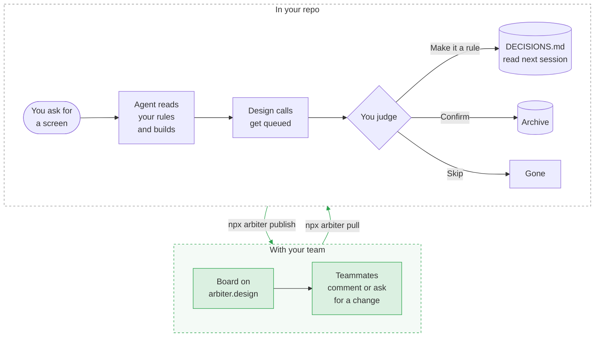

<div align="center">

<picture>
  <source media="(prefers-color-scheme: dark)" srcset=".github/assets/banner-dark.png">
  
</picture>

### Arbiter: open-source design decision memory

[](https://www.npmjs.com/package/arbiterdesign)
[](https://arbiter.design/changelog)
[](LICENSE)
[](package.json)
[](https://claude.com/claude-code)
[](https://cursor.com)

**[Website](https://arbiter.design)** · **[Live demo](https://arbiter.design/p/acme)** · **[Start guide](https://arbiter.design/get-started)** · **[Changelog](https://arbiter.design/changelog)**

[How it works](#how-it-works) · [Share with your team](#share-it-with-your-team) · [FAQ](#faq) · [Reference](#reference)

</div>

<br>

Arbiter turns the design decisions made while you build into rules your agent follows and reasons your team can find. It works with Claude Code and Cursor.

As your agent builds, Arbiter writes down each design call: what changed, what it beat, and why. You approve them in seconds, in chat or on your board. The agent follows them next time, and everyone on your team can read them.

<p align="center">
  <picture>
    <source media="(prefers-color-scheme: dark)" srcset=".github/assets/hero-dark.gif">
    
  </picture>
</p>

<p align="center"><sub>Your board: every screen, what was decided on it, who decided, and what it beat. <a href="https://arbiter.design/p/acme">Click around the live demo</a>.</sub></p>

<br>

## What you get

### Consistency

**Your agent follows your design rules.**<br>
Make a call once and it becomes a rule in `DECISIONS.md`, which the agent reads before any UI work. No more re-explaining.

### Traceability

**Build fast without losing the why.**<br>
Every design decision and change is recorded as it's made: what was chosen, what it beat, who decided and when.

### Visibility

**See every decision in one place.**<br>
Your board shows each screen, the decisions made on it, and what lost. It runs on your machine, and you share it when your team should see it too.

<br>

## Why Arbiter

Building with an agent means making product decisions all day, and nobody keeps track of them.

- **The agent forgets between sessions.** On Tuesday you tell it *"no tabs, keep settings on one page."* On Thursday, in a new session, the tabs are back.
- **Nothing gets written down.** Five screens ship before lunch, each one full of calls about layout, copy and flow. None of them are recorded anywhere.
- **The reasoning gets lost.** Someone asks in review why it's a modal. There was a good reason, but it was in a chat three weeks ago.

Arbiter fixes that without adding work:

- 📄 **It's just files in your repo.** Rules live in `DECISIONS.md`. Plain markdown, reviewed in pull requests like everything else.
- 🤫 **It stays out of the way.** No popups while you iterate. The agent queues what it decided and you judge it when you're ready, in chat or on your board.
- 🧭 **It informs, it doesn't enforce.** Rules shape what the agent builds. When your request goes against one, it asks once, then builds what you choose. Nothing blocks a build.

<br>

## How it works

<table>
<tr>
<td width="33%" valign="top">

<picture>
  <source media="(prefers-color-scheme: dark)" srcset=".github/assets/how-chat-dark.gif">
  
</picture>

**1. Build, then review in chat**

Ask for a screen as you always do. Your agent reads your rules first. When decisions pile up, it asks: confirm each one, make it a rule, or type what it should be.

</td>
<td width="33%" valign="top">

<picture>
  <source media="(prefers-color-scheme: dark)" srcset=".github/assets/how-beat-dark.gif">
  
</picture>

**2. Review on your board**

Or open your board with `npx arbiter review`: every change with its picture and what it beat. It runs on your machine, and nothing is uploaded until you publish.

</td>
<td width="33%" valign="top">

<picture>
  <source media="(prefers-color-scheme: dark)" srcset=".github/assets/how-exceptions-dark.gif">
  
</picture>

**3. Rules and exceptions**

Rules go into `DECISIONS.md`, and your agent follows them from then on. When one screen needs to differ, keep it as an exception.

</td>
</tr>
</table>

You can also just say it in chat: *"make that a rule"*, or *"reject the tabs, going with a single page."*

<details>
<summary><b>The whole loop, as a diagram</b></summary>
<br>

In your repo, the agent builds, queues its design calls, and you judge them. Rules go into `DECISIONS.md` for the next session. With Arbiter Team, publish the board and your team can comment or ask for a change, which `pull` brings back.



</details>

<details>
<summary><b>What a rule looks like in <code>DECISIONS.md</code></b></summary>
<br>

```markdown
### D-0006 · Settings live on one scrolling page with a section nav, not tabs

- **Change:** Settings moved from four tabs to one page with a section nav
- **Rationale:** People look for a setting with ⌘F, and tabs hid it
- **Rejected:**
  - Tabs, one per section — they hid settings from ⌘F
- **Trigger:** Settings build
- **Scope:** pattern:settings-layout · **Dimension:** structure · **Level:** pattern · **Class:** judgment · **Verdict:** rule
- **Author:** sam · **Date:** 2026-10-27T09:00:00Z · **Commit:** — · **Supersedes:** —
```

</details>

<br>

## When something clashes with a rule

The agent asks before building, once, and always the same way: what it found, one question, and two or three options plus Other. It only speaks up when one of your rules is involved.

- **You ask for something a rule goes against.** *"Do you still want the undo bar?"* Follow the rule, make a one-off exception, or replace the rule.
- **A rule goes against your design system.** *"Which should the empty list follow?"* Retire the rule, or reword it as an exception to the design system.
- **Two rules disagree.** *"Which should they follow?"* Retire one, or reword both to say what each is for.
- **Other screens don't follow a rule you just made.** *"Update Events too?"* Update them, review it later, or keep them as exceptions.
- **A rule needs something your design system doesn't have.** *"Build one?"* A short plan first, this screen only, or review it later.

Your design system (`DESIGN.md`, your pattern and component docs, and your shared components) outranks a plain rule. A rule written as an exception outranks the design system. Arbiter never edits your design system and never checks your work against it.

<br>

## Where Arbiter fits

Your agent has good taste and your design system, and still drifts from what your team decided. Arbiter adds the layer that stops the drift: your own design calls, with the reason.

| Layer | Where it lives | What it holds |
|---|---|---|
| Taste packs | Design skills, taste packs | Generic taste, anyone's |
| References | Design references, Mobbin | Design references and judgment |
| Written law | `DESIGN.md`, `CLAUDE.md`, `tokens.json` | Defined tokens, components and usage |
| **Case law** | **`DECISIONS.md`, kept by Arbiter** | **Your team's calls, with a reason, an owner and a date** |
| Examples | Storybook, Figma | Your approved screens and code |

<br>

## Share it with your team

Your board is private to you. To share it, use **Share board** at the top of your board, or the same two options here.

### A read-only copy

Free, and nothing goes to Arbiter. Export your board as a folder anyone can open from disk or put on any static host:

```
npx arbiter export
```

Or put it on your own GitHub Pages site with `npx arbiter publish --to pages`.

### Arbiter Team (early access)

A private board on arbiter.design where your team comments, says "looks good", and requests changes. Teammates sign in with an email link, and there's nothing to install. Arbiter Team is in early access, by invitation: [request early access](https://arbiter.design/plans).

<details>
<summary><b>Once you're in</b></summary>
<br>

`npx arbiter publish` puts your board online and gives you a link. It's unlisted and never indexed.

`npx arbiter pull` brings comments and change requests back into your project. A comment is just input. A change request gets a proper answer: you reply in chat with `/arbiter` (apply it, apply it with a tweak, or decline with a reason), the agent makes the change, and your next `publish` shows them what happened. Nothing is applied without your yes, and the board never writes to your project on its own.

- **Keep it current.** `npx arbiter publish --auto` republishes whenever the record changes. `--on-push` sets up a GitHub Action that republishes when decisions land on your default branch.
- **Keep it private.** `npx arbiter publish --password` puts it behind a password and prints one for you to send with the link.
- **Take it down.** `npx arbiter unpublish --yes` deletes the online copy and its comments, after saving the comments into your project.

Your project stays the source of truth. Only `publish`, `pull` and `unpublish` talk to the online service.

</details>

<br>

## Under the hood

It's just files in your project. You own them, and they're reviewed in pull requests like everything else.

<details>
<summary><b>The files Arbiter keeps</b></summary>
<br>

| File | What it's for |
|---|---|
| `DECISIONS.md` | Your active rules, grouped by type. 40 at most by default, or set your own. The agent reads this before UI work. |
| `.arbiter/archive.md` | Every decision ever made, append-only. Never loaded into the agent. |
| `.arbiter/pending.md` | Decisions the agent queued that you haven't judged yet, in chat or on the board. |
| `.arbiter/candidates/` | One page per competing direction: its state, picture, decisions, and why it lost. |
| `.arbiter/work/` | A picture per piece of work, and the ones before it, so the board shows how it got there. |
| `.arbiter/areas.json` | The folders you make for areas in the board's side nav. |
| `.arbiter/hosted.json`, `comments.json`, `requests.json` | Which online board is yours, and the comments and change requests `pull` brings back. |
| `CANDIDATES.md` | Index of candidates. Only written when `destination` is `git`. |
| `.claude/skills/arbiter/SKILL.md` or `.cursor/rules/arbiter.mdc` | Tells the agent to check your rules before UI work, ask when something clashes with one, surface its decisions after, record what you confirm, and pick up what you judged on the board. |
| `arbiter.json` | Settings: when the agent checks in, the rule cap, where your app runs for pictures. |
| `AGENTS.md` | One line appended, pointing at `DECISIONS.md`. It tells the agent to ask before building when your request or the design system goes against a rule, and that a rule written as an exception beats the design system. Merged, never overwritten. |
| `CLAUDE.md` / `.cursor/commands/arbiter.md` | The same pointer for Claude Code, and an `/arbiter` command for Cursor. |

</details>

<br>

## FAQ

<details>
<summary><b>What counts as a decision?</b></summary>

A call the agent made where a reasonable alternative existed: layout, flow, wording, states, what happens on error, and what it chose over. Not code details like imports, file names or plumbing. Each one reads Change, Rule, Rejected.

</details>

<details>
<summary><b>How do I set it up?</b></summary>

One command, in the folder your agent works in. In the terminal you already use with Claude Code or Cursor, type `npx arbiterdesign init`, or ask the agent to run it. It adds a few plain files to the project and a one-line note telling the agent to read the rules before UI work. Nothing to sign up for, nothing to configure. From the next session, the agent records as it goes. When you want to share your board, `npx arbiter export` makes a read-only copy, and Arbiter Team (early access) gives your team a private link. Step by step, with what you'll see: [Get started](https://arbiter.design/get-started).

</details>

<details>
<summary><b>Will it interrupt me, or bury me in reviews?</b></summary>

No. Decisions queue quietly while you work and come up in one line when you move on. One-off fixes aren't recorded at all, so you only judge calls that matter.

</details>

<details>
<summary><b>Can I change my mind about a rule?</b></summary>

Yes. Make the new call and the old rule steps aside. It stays in the archive with the reason it was replaced, so the history reads as history. Nothing is deleted.

</details>

<details>
<summary><b>Where does the record live, and who can see it?</b></summary>

In your project, as plain-text files you own: `DECISIONS.md` and a folder beside it. Your board runs on your machine and reads those files: no account, and nothing is uploaded. Only you see it. When you want others to see it, `npx arbiter export` makes a read-only copy, or Arbiter Team (early access) puts one at a private link: unlisted, never indexed, comments by email sign-in. Delete that copy and you lose the comments, nothing else.

</details>

<details>
<summary><b>We already have a design system.</b></summary>

Good. Arbiter records decisions, not tokens. Rules can name your components and files (*"interactive elements use brand tokens, never raw hex"*) and sit beside whatever system you have. It captures the calls a design system doesn't: layout, flow, copy, and what was rejected.

</details>

<details>
<summary><b>Is this like ADRs?</b></summary>

Yes, same idea: a call, what it beat, and why. ADRs (architecture decision records) are for engineering: the stack, the data model, the API. Arbiter is for design: layout, flow, copy and states. And no one writes it up. The agent records each call as it works and you approve in seconds.

</details>

<details>
<summary><b>Doesn't Claude have memory now?</b></summary>

Yes, but memory is what the agent learned. Arbiter is what your team decided. Claude Code's auto memory is notes Claude keeps for itself: nobody approves them, and they stay on one machine. Arbiter's rules are ones you approved, kept in the repo for every teammate, and each one records what it beat and what it replaced.

</details>

<br>

## Reference

You won't need most of this day to day: the agent runs these for you. It's here for design engineers who want the details.

The commands you'll use most:

```
npx arbiterdesign init     # install into this project
npx arbiter review         # open your board
npx arbiter rules          # list your rules
npx arbiter export         # a read-only copy of your board to share
npx arbiter update         # get the newest Arbiter
npx arbiter publish        # Arbiter Team: put your board online
npx arbiter pull           # Arbiter Team: bring comments and requests back
```

> [!NOTE]
> On Windows, in PowerShell, type `npx.cmd` instead of `npx`. PowerShell blocks plain `npx` out of the box, with "running scripts is disabled on this system". Command Prompt and Git Bash don't.

> [!TIP]
> Too chatty? `npx arbiter setup --checkin quiet` turns off the check-ins. `--checkin every` does the opposite and mentions a rule every time one changed something.

<details>
<summary><b>Full command reference</b></summary>

#### Setup

| Command | What it does |
|---|---|
| `arbiter init [--destination git]` | Install into this project. |
| `arbiter setup --checkin <mode>` | How often the agent checks in: `feature`, `quiet` or `every`. |
| `arbiter setup --app <url>` | Where the app runs, so the agent can open screens for pictures. |
| `arbiter update [--check]` | Install the newest Arbiter, refresh the skill file, re-pin the workflow. |

#### Recording

| Command | What it does |
|---|---|
| `arbiter record` | Walk through a decision at the terminal. |
| `arbiter record '<json>'` | Record now (what the agent calls). |
| `arbiter record --pending '<json>'` | Queue for later. |
| `arbiter record P-0003 --as rule` | Judge a queued item: `accept`, `rule`, `skip` or `fix --to "…"`. Add `--candidate C-0001` to link it, or `--against D-0009` to name the rule it goes against (with `accept`, it's logged as an exception to that rule). |
| `arbiter record --all --as accept` | Judge every queued item. Narrow with `--level pattern` or `--trigger "Settings build"`. |
| `arbiter record --findings f.json` | Queue a scanner's findings for verdicts. |
| `arbiter record --retire D-0003 --why "…"` | Drop a rule with no replacement. |
| `arbiter record --reword D-0003 --to "…"` | Change a rule's wording. It keeps its id, and the old wording stays on the entry. |
| `arbiter record R-0001 --as apply` | Answer a request: `apply [--to "<instead>"]` or `decline --why "…"`. |
| `arbiter record '<json>' --request R-0001` | Record the change made for an approved request, which applies it. |
| `arbiter snapshot "<work>" --file x.png` | Attach a picture to a piece of work (or `--capture` on macOS). |

#### Reviewing and inspecting

| Command | What it does |
|---|---|
| `arbiter review` | Your local board, in the browser: what's waiting for you to judge, every change with its picture, and your design rules. It keeps itself current while it's open, and stops when you close its tab. Nothing is uploaded. What still needs a code change reaches your agent with your next message in Claude Code (a hook `init` installs), or at the next `/arbiter`. |
| `arbiter review --json` | For an agent that waits on the board: when its last tab closes, hands over what you decided as JSON. |
| `arbiter review --done` | For the agent, once it has made what the board handed it: clears that, and keeps anything you judged meanwhile. |
| `arbiter rules [--dimension <name>] [--json]` | Active rules. |
| `arbiter rules --pending` | The queue, plus requests waiting on an answer. |
| `arbiter rules --archive` | Everything ever recorded. |
| `arbiter rules D-0003` | One decision (or `R-0001`, one request) in full. For a rule, also its exceptions and the clashes waiting on it, so the agent doesn't ask about the same screen twice. |
| `arbiter verify [id]` | Re-check a decision's claim against its files. |
| `arbiter sweep D-0004 [--queue]` | Find existing violations of a mechanical rule. |
| `arbiter drift` | Deviations per screen: accepts, unverified claims, broken rules. |

#### Screens

| Command | What it does |
|---|---|
| `arbiter candidate add "<name>"` | Track a generated direction. Options: `--feature f`, `--snapshot img`, `--capture`. |
| `arbiter candidate C-0002 --state …` | Set its state. |
| `arbiter board` | Candidates and their states. |
| `arbiter unlink D-0004` | Detach a decision from the screen it was recorded against. |
| `arbiter rename "<work>" "<new name>"` | Rename a piece of work everywhere the record keeps it. Its comments on the board follow at the next publish. |
| `arbiter remove <id>` | Remove a decision, a screen (`C-0001`) or a picture (`--snapshot "<work>"`) that was never real. |

#### Sharing

`export` and `publish --to pages` work for everyone. The rest is Arbiter Team (early access).

| Command | What it does |
|---|---|
| `arbiter publish` | Board online at arbiter.design, with comments. Prints the share link. |
| `arbiter publish --to <url\|pages>` | Your own hosted Arbiter, or GitHub Pages. |
| `arbiter publish --auto` | Republish whenever the record changes. |
| `arbiter publish --on-push` | Write a GitHub Actions workflow that republishes on every push. |
| `arbiter publish --password [pw]` | Ask for a password before showing the board. No value makes one up. `--no-password` takes it off. |
| `arbiter unpublish --yes` | Delete the board, its pictures and its comments, saving the comments to the repo first. |
| `arbiter unpublish <board link> --admin --yes` | For whoever runs the server: take down any board on it, with the admin token in `ARBITER_ADMIN_TOKEN`. |
| `arbiter pull` | Bring comments and reactions into `.arbiter/comments.json`, and requests into `.arbiter/requests.json`. |
| `arbiter export [--feature f] [--include-rules] [--open]` | Static folder of the board for people without the repo. |

#### Exit codes for `record`

| Code | Meaning |
|---|---|
| `0` | Recorded. |
| `1` | Invalid input. |
| `2` | Overlaps an existing rule. Re-run with `--supersedes <id>` or `--keep-both`. |
| `3` | The rule cap is reached. |
| `4` | Contradicted: the named files don't match the claim. |

</details>

<details>
<summary><b>Pictures of your screens</b></summary>
<br>

The agent takes one picture per piece of work, when the work settles and it changed how a specific screen looks.

- **Gets a picture:** layout, wording or visual changes to one screen. Even a small pattern change counts.
- **Doesn't:** font or token changes (no single screen to show), motion and behaviour (a still can't show it), and small one-off fixes (they aren't recorded).

The agent renders pictures with a headless browser. If it can't (no browser, app not running, screen behind a login) it tells you once and says why. On macOS, `--capture` lets you drag-select a picture yourself; elsewhere, save one and pass `--file`.

Name each piece of work after the screen it changed, like `Settings, billing` instead of one `Settings build` across four routes. Then one picture per piece of work means one per screen. Named it something else first? `arbiter rename "Settings build" "Settings, billing"` moves its decisions, its picture and its comments to the new name.

Cards without a picture show an icon of the kind of change, so the board never looks broken. To make sure missing pictures still get noticed, `record` tells the agent the command to add one, the board marks the group "No picture", and `publish` lists the cards that are missing one.

</details>

<details>
<summary><b>Change requests in detail</b></summary>
<br>

1. `npx arbiter pull` turns each request into `R-0001` in `.arbiter/requests.json`. Commit it so everyone sees the same answers.
2. You answer in chat with `/arbiter`:
   - **Apply**: `record R-0001 --as apply`
   - **Apply, but…**: `record R-0001 --as apply --to "keep the tab, make the button red"`
   - **Decline**: `record R-0001 --as decline --why "…"` (a reason is required, since the requester reads it)
3. The agent makes the change right away.
4. `publish` sends the answer back. The requester sees *Open*, *Approved*, *Applied* (with what changed) or *Declined* (with the reason).

- Pulling twice never creates the same request twice. If the requester deletes it on the board before it's made, the next pull takes it off the queue and says so.
- Only an approved request can be applied. A change the owner hasn't said yes to is refused.
- Removing the last decision that applied a request reopens it for a fresh answer. The agent never remakes it unasked.
- A screen or decision with a request waiting on it can't be removed until the request is declined or applied.
- Display names and comment text come from outside the project, so neither is trusted. Names arrive as a single line, and nothing they contain can add a line, entry or field to the record.

</details>

<details>
<summary><b>More on sharing</b></summary>
<br>

- The service only holds the latest board and its comments. A board holds up to 100 pictures (25 MB); a picture that doesn't fit is left off and `publish` says so.
- `publish --auto` works anywhere: no GitHub, no CI, no repo needed. If a republish fails (offline, service down) the command still succeeds and tells you the board is behind. `--no-auto` turns it off.
- `publish --on-push` writes the workflow and sets the `ARBITER_PUBLISH_TOKEN` secret through `gh` if you're signed in. Commit the workflow along with `.arbiter/hosted.json`.
- `publish --password` makes up a strong password and prints it once. `--password "<yours>"` sets your own (8 characters or more), `--no-password` takes it off, and a plain `publish` leaves it as it is.
- `unpublish` without `--yes` only says what it would delete.
- Lost the project folder, so you can't run `unpublish`? Use **Report or remove this board** at the bottom of the board, and it's taken down by hand.
- `export` writes `arbiter-export/`: the same board as `arbiter review`, read-only (`index.html`, the board's script and styles, and the pictures). With `--include-rules`, your design rules too.
- With `"destination": "git"` in `arbiter.json`, every candidate change also writes the export to `docs/arbiter/`. Turn on Pages for the `docs` folder once and the board lives at `https://<owner>.github.io/<repo>/arbiter/`.

</details>

<details>
<summary><b>Keeping the record honest: verify and sweep</b></summary>
<br>

A mechanical rule (a hex colour ban, say) can name the `files` it applies to and what should be `present` in or `absent` from them. Use `regex:<pattern>` for patterns, like `regex:#[0-9a-fA-F]{6}\b` for any hex colour.

- **Verify.** Arbiter reads only those files and refuses a claim that doesn't hold.
- **Sweep.** `npx arbiter sweep D-0004` lists every existing line that breaks the rule. `--queue` turns each file into a pending item to fix or keep as an exception. Sweep never edits code; fixing is the agent's job.

Keep token files and reference HTML out of sweeps in `arbiter.json`:

```json
{
  "sweep": { "exclude": ["app/globals.css", "design-reference/**", "docs/**"] },
  "overlap": { "ignore": ["audit", "journey"] }
}
```

`overlap.ignore` lists words too common in your project to signal that two rules overlap.

</details>

<details>
<summary><b>Taking something out</b></summary>
<br>

Three different things, and only one of them deletes.

| | When to use it | Command |
|---|---|---|
| **Retire** | It was real, and it's over | `arbiter record --retire D-0003 --why "…"` |
| **Remove** | It was never real (a test, a misfire) | `arbiter remove D-0004` |
| **Unlink** | It's real, but attached to the wrong screen | `arbiter unlink D-0004` |

Changing your mind is history worth keeping, so judgments are never deleted, only superseded. Mistakes are different: a record that says something false makes the archive less trustworthy. `remove` deletes it everywhere and prints the full record it removed. It refuses while anything still points at the record, unless you pass `--force` to unlink screens in one go. `remove --snapshot "<work>"` takes away just the picture.

</details>

<details>
<summary><b>Competing directions (candidates)</b></summary>
<br>

When the agent generates several directions for one feature, each one is a candidate with a state: `generated`, `in_review`, `approved`, `rejected` or `superseded`. Approving one supersedes the rest and keeps the reason. Decisions link to the candidate they were made for, and `arbiter board` lists them all.

</details>

<details>
<summary><b>The record format</b></summary>
<br>

| Field | Meaning |
|---|---|
| `id` | `D-0001`, sequential. |
| `date` | ISO 8601. |
| `author` | Who decided. |
| `class` | `mechanical` (checkable in code) or `judgment`. |
| `level` | `feature` or `pattern`. How big a call it is. A `polish` one-off fix isn't recorded: `record` answers `not-recorded` and writes nothing. |
| `dimension` | `structure`, `interaction`, `states`, `content`, `visual`, `motion` or `access`. |
| `change` | What happened, in plain words. What the reviewer reads. |
| `decision` | The same call written as a rule. What future sessions read. |
| `rejected` | Alternatives that lost, one per line as `<option> — <why>`. |
| `trigger` | The piece of work, like `Settings build`. Used to group the review. |
| `verdict` | `fix`, `accept`, `rule` or `retire`. |
| `call` | Who made the call: `asked`, `corrected` or `agent`. `null` on records from before 0.1.7. |
| `against` | The rule this goes against, like `D-0011`, or `null`. Queued, it's a clash for review. Accepted, it's an exception to that rule. |
| `reworded` | The rule's earlier wordings, as `<old> (until 2026-10-13)`. Only `record --reword` adds one. |
| `scope` | `global`, `file:<path>` or `pattern:<name>`. |
| `rationale` | One line, required. |
| `supersedes` | The id it replaces, or `null`. |
| `commit` | Short SHA, or `null`. |
| `files` | Files the agent touched. Evidence for verification. |
| `paths` | Where a rule applies. What sweep scans. |
| `expect` | `{ present?: [..], absent?: [..] }`, strings to check in `files`. |
| `verified` | `true`, `false` or `null` (never checked, or not checkable). |
| `candidate` | `C-0001`, or `null`. |

Only `rule` verdicts go into `DECISIONS.md`. A rule that overlaps an active one is refused until you say whether it replaces it. Superseded rules leave the active file and stay in the archive. `accept` verdicts are never verified, since an exception is a deviation by definition.

Rewording is the one change made in place. The id stays, so everything that names the rule still points at it, and the entry keeps its earlier wording. A rule that now says something different isn't reworded. It's superseded.

</details>

### Updating

```bash
npx arbiter update
```

Two things can go out of date separately: the package in your devDependencies, and the skill file `init` copied into your project. Arbiter can tell when they don't match, without going online, and the agent will mention it in one line. `update` installs the newest package, refreshes the skill file, and re-pins the publish workflow if you have one. Your settings, `DECISIONS.md` and archive are left alone. `--check` reports without changing anything.

<br>

## Development

```bash
npm install
npm run build
npm test
```

Requires Node 20 or newer. Issues and ideas are welcome on the [issue tracker](https://github.com/eddie199/arbiter/issues).

<br>

## License

[MIT](LICENSE) © Edmond Hua
