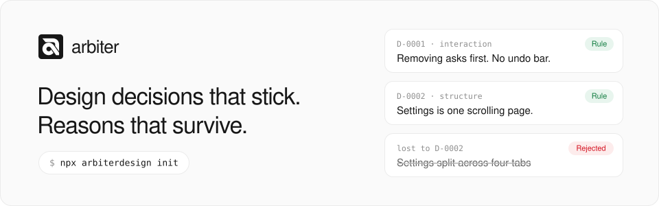
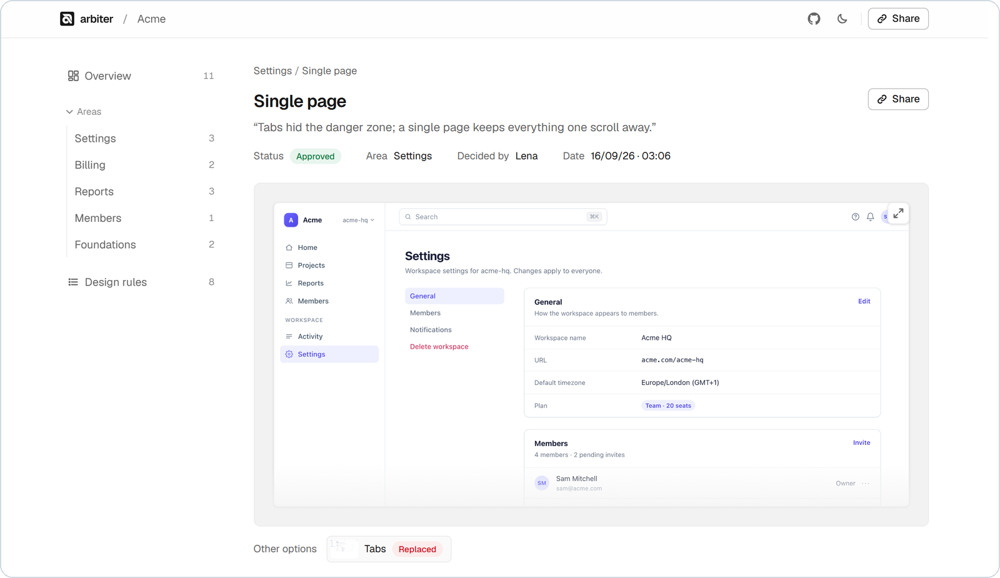
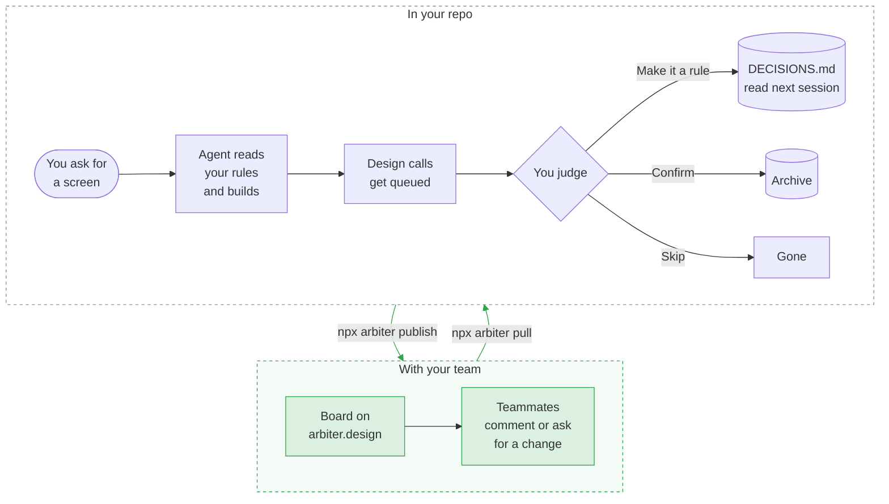

<div align="center">

<picture>
  <source media="(prefers-color-scheme: dark)" srcset=".github/assets/banner-dark.svg">
  
</picture>

### The decision layer for agent-built UI

[](https://www.npmjs.com/package/arbiterdesign)
[](https://arbiter.design/changelog)
[](LICENSE)
[](package.json)
[](https://claude.com/claude-code)
[](https://cursor.com)

**[Website](https://arbiter.design)** · **[Live demo](https://arbiter.design/p/acme)** · **[Start guide](https://arbiter.design/get-started)** · **[Changelog](https://arbiter.design/changelog)**

[Quick start](#quick-start) · [How it works](#how-it-works) · [Share with your team](#share-it-with-your-team) · [Commands](#commands) · [FAQ](#faq)

</div>

<br>

## What is Arbiter?

Arbiter is a decision record for teams building UI with AI agents like Claude Code and Cursor.

As your agent builds, it writes down the design calls it makes: what it chose, what it beat, and why. You approve them in seconds. The agent follows them next time, and everyone on your team can read them.

It's documentation that writes itself.

<p align="center">
  <picture>
    <source media="(prefers-color-scheme: dark)" srcset=".github/assets/board-dark.png">
    
  </picture>
</p>

<p align="center"><sub>A screen on the board: what was decided, who decided it, and what it beat. <a href="https://arbiter.design/p/acme">Try the live demo</a>.</sub></p>

## What you get

### Consistency

**Your agent follows your design rules.**<br>
Make a call once and it becomes a rule in `DECISIONS.md`, which the agent reads before any UI work. No more re-explaining.

### Traceability

**Build fast without losing the why.**<br>
Every design decision and change is recorded as it's made: what was chosen, what it beat, who decided and when.

### Visibility

**See every decision in one place.**<br>
Publish a board so you and your team can see each screen, the decisions made on it, and what lost.

## Why Arbiter

Building with an agent means making product decisions all day, and nobody keeps track of them.

- **The agent forgets between sessions.** On Tuesday you tell it *"no tabs, keep settings on one page."* On Thursday, in a new session, the tabs are back.
- **Nothing gets written down.** Five screens ship before lunch, each one full of calls about layout, copy and flow. None of them are recorded anywhere.
- **The reasoning gets lost.** Someone asks in review why it's a modal. There was a good reason, but it was in a chat three weeks ago.

Arbiter fixes that without adding work:

- 📄 **It's just files in your repo.** Rules live in `DECISIONS.md`. Plain markdown, reviewed in pull requests like everything else.
- 🤫 **It stays out of the way.** No popups while you iterate. The agent queues what it decided and you judge it when you're ready.
- 🧭 **It informs, it doesn't enforce.** Rules shape what the agent builds. Nothing blocks a build.

## Quick start

```bash
npx arbiterdesign init
```

> [!NOTE]
> On Windows, in PowerShell, type `npx.cmd` instead of `npx`, here and in every command after. PowerShell blocks plain `npx` out of the box, with "running scripts is disabled on this system". Command Prompt and Git Bash don't.

That's the whole install. Run it in the folder your agent works in, or ask the agent to run it. It detects Claude Code or Cursor, teaches your agent the protocol, and adds `arbiterdesign` to your devDependencies, which is what makes the shorter `npx arbiter` work from then on. Running it twice changes nothing.

No `package.json` in the project? Add `arbiterdesign` as a dev dependency yourself. New to the terminal? Follow the [step-by-step guide](https://arbiter.design/get-started).

If you want the agent to take screenshots of the screens it changes, tell it where your app runs:

```bash
npx arbiter setup --app http://localhost:3000
```

Then build UI the way you normally do. Arbiter picks it up from there.

<details>
<summary><b>The files Arbiter keeps in your repo</b></summary>
<br>

| File | What it's for |
|---|---|
| `DECISIONS.md` | Your active rules, grouped by type. Capped at 40. The agent reads this before UI work. |
| `.arbiter/archive.md` | Every decision ever made, append-only. Never loaded into the agent. |
| `.arbiter/pending.md` | Decisions the agent queued that you haven't judged yet. |
| `.arbiter/candidates/` | One page per generated screen or direction: its state, snapshot, decisions, and why it lost. |
| `.arbiter/work/` | One picture per piece of work, when the agent could take one. `publish` carries it to the board. |
| `.arbiter/hosted.json`, `comments.json`, `requests.json` | Which hosted board is yours, and the comments and change requests `pull` brings back. |
| `CANDIDATES.md` | Index of candidates. Only written when `destination` is `git`. |
| `.claude/skills/arbiter/SKILL.md` or `.cursor/rules/arbiter.mdc` | Tells the agent to check your rules before UI work, ask when something clashes with one, then surface its decisions and record what you confirm. |
| `arbiter.json` | Config. `app.url` is where the agent opens screens for pictures. |
| `AGENTS.md` | One line appended, pointing at `DECISIONS.md`. It tells the agent to ask before building when your request or the design system goes against a rule, and that a rule written as an exception beats the design system. Merged, never overwritten. A newer `init` refreshes only that line. |
| `CLAUDE.md` / `.cursor/commands/arbiter.md` | The same pointer for Claude Code, and an `/arbiter` command for Cursor. |

</details>

## How it works



1. **You ask for a screen.** The agent reads `DECISIONS.md` first. After a sizeable piece of work it names up to three rules that shaped it, like *Following D-0001 (removing asks first, no undo bar)*, so you can see the record working.
2. **You iterate.** The agent says nothing about decisions while you're going back and forth. Each version you move past becomes a rejected alternative on the one that replaced it.
3. **You move on.** The agent queues the design calls it made, sized as `feature`, `pattern` or `polish`. When 5 are waiting (then 10, 15…) it asks if you want to review them. Polish doesn't count toward that. Only real choices get queued: things you asked for, things you corrected, and options the agent actually weighed. Its habits don't.
4. **You judge them when you want.** In chat with `/arbiter`, or in the browser with `npx arbiter review`.
5. **Rules go into `DECISIONS.md`.** Everything you judged goes into the archive. Skipped items disappear. The next session reads the new rules.
6. **You share it.** `npx arbiter publish` puts the board online, so your team can see each screen, what was decided and why. They can comment or request a change, and `npx arbiter pull` brings that back for you to answer. More in [Share it with your team](#share-it-with-your-team).

You can also just say it: *"make that a rule"*, or *"reject the tabs, going with a single page."* The agent records it without asking.

### What a rule looks like

```markdown
### D-0001 · Destructive actions confirm in a modal, never inline

- **Change:** The delete-project link now opens a confirm modal
- **Rationale:** Inline confirms get clicked through; a modal forces the pause.
- **Rejected:**
  - Inline confirm — clicked through without reading
- **Trigger:** Delete-project flow used an inline "Are you sure?" link
- **Scope:** pattern:destructive-confirm · **Dimension:** interaction · **Level:** pattern
```

### Judging the queue

Each item reads as **Change** (what happened), **Pattern** (the rule) and **Rejected** (what lost). For each one you pick:

| Action | What happens |
|---|---|
| **Confirm** | Goes into the archive as a one-off. |
| **Make it a rule** | Goes into `DECISIONS.md`. The agent follows it from now on. |
| **Skip** | Thrown away. |
| **Fix** | Type a correction and it's recorded your way. |

Polish items come as one line per group with a single **Confirm all**. If an item goes against an existing rule, Arbiter says so (*Clashes with D-0009*) and asks which one wins: **Follow D-0009**, **Replace D-0009**, or **Keep as exception**.

> [!TIP]
> Too chatty? `npx arbiter setup --checkin quiet` turns off the check-ins. `--checkin every` does the opposite and mentions a rule every time one changed something.

### When something clashes with a rule

The agent asks before building, once, and always in the same shape: *Before building, Arbiter found a clash*, the facts, one question, and two or three options plus Other. It only speaks up when a rule is involved.

| Clash | It asks | Your answer goes into the record as |
|---|---|---|
| You ask for something a rule goes against | *Do you still want the undo bar?* | Nothing (it follows the rule), a one-off exception, or a new rule replacing the old one |
| A rule goes against the design system | *Which should the empty list follow?* | The rule retired, or reworded as *Exception to the design system: …* |
| Two rules disagree (only when both can't be true) | *Which should they follow?* | The other one retired, or both reworded to say what each is for |
| Other screens don't follow a rule you just built to (asked after building) | *Update Events too?* | Nothing (it updates them), a clash on your review list, or an exception |
| A rule needs something the design system doesn't have | *Build one?* | A short plan first, then this screen only, or a clash on your review list |

The design system means `DESIGN.md`, pattern and component docs, and the shared components. It ranks above a plain rule, so it's the first option when the two disagree. A rule written as an exception beats it, and the agent follows that rule without asking.

The agent never edits the design system, never adds to the shared components to fit a rule without asking, and never checks your work against it. That stays with your own tooling.

## Share it with your team

### The hosted board

```bash
npx arbiter publish
```

Puts your board online at [arbiter.design](https://arbiter.design) and prints a share link. Nothing to set up. People sign in with a magic link and can comment, say "looks good", or request a change on any screen. See what one looks like in the [live demo](https://arbiter.design/p/acme).

```bash
npx arbiter pull
```

Brings their comments back into your repo, where `arbiter review` shows them next to each screen.

Git stays the source of truth. The service only holds the latest board and its comments, and only `publish` and `pull` ever touch the network. A board holds up to 100 pictures (25 MB); a picture that doesn't fit is left off and `publish` says so.

**Keep it current automatically:**

- `npx arbiter publish --auto` republishes whenever the record changes. Works anywhere: no GitHub, no CI, no repo needed. If a republish fails (offline, service down) the command still succeeds and tells you the board is behind. `--no-auto` turns it off.
- `npx arbiter publish --on-push` writes a GitHub Actions workflow that republishes when decisions land on your default branch, and sets the `ARBITER_PUBLISH_TOKEN` secret through `gh` if you're signed in. Commit the workflow along with `.arbiter/hosted.json`.

**Keep it private, or take it down:**

- `npx arbiter publish --password` puts the board behind a password. It makes up a strong one and prints it once, so send it with the link. `--password "<yours>"` sets your own (8 characters or more), `--no-password` takes it off, and a plain `publish` leaves it as it is.
- `npx arbiter unpublish --yes` deletes the board, its pictures and its comments from the service, saving the comments into `.arbiter/comments.json` first. Without `--yes` it only says what it would delete.
- Lost the project folder, so you can't run it? Use **Report or remove this board** at the bottom of the board, and it's taken down by hand.

### Change requests

A comment is just input. **Request change** is different: someone wants something changed, so it gets a proper answer.

1. `npx arbiter pull` turns each request into `R-0001` in `.arbiter/requests.json`. Commit it so everyone sees the same answers.
2. You answer in chat with `/arbiter`, or on the **Requests** tab of `arbiter review`:
   - **Apply**: `record R-0001 --as apply`
   - **Apply, but…**: `record R-0001 --as apply --to "keep the tab, make the button red"`
   - **Decline**: `record R-0001 --as decline --why "…"` (a reason is required, since the requester reads it)
3. The agent makes the change. Approving from chat makes it right away; approving from the review page makes it at the next `/arbiter`.
4. `publish` sends the answer back. The requester sees *Open*, *Approved*, *Applied* (with what changed) or *Declined* (with the reason).

> [!NOTE]
> Nothing gets applied without the owner saying yes, and the board never writes to git. Requests come in through `pull` and answers go out through `publish`.

<details>
<summary><b>More on requests</b></summary>
<br>

- Pulling twice never creates the same request twice. If the requester deletes it on the board before it's made, the next pull takes it off the queue and says so.
- Only an approved request can be applied. A change the owner hasn't said yes to is refused.
- Removing the last decision that applied a request reopens it for a fresh answer. The agent never remakes it unasked.
- A screen or decision with a request waiting on it can't be removed until the request is declined or applied.
- Display names and comment text come from outside the project, so neither is trusted. Names arrive as a single line, and nothing they contain can add a line, entry or field to the record.

</details>

### Other ways to share

- **Static export.** `npx arbiter export` writes `arbiter-export/`: one `index.html` plus snapshots, no server, no JavaScript. Drop it on any static host. It's a read-only view: each screen, its state, who approved it, why the others lost, and what was decided in plain words.
- **GitHub Pages.** With `"destination": "git"` in `arbiter.json`, every candidate change also writes the export to `docs/arbiter/`. Turn on Pages for the `docs` folder once and the board lives at `https://<owner>.github.io/<repo>/arbiter/`. `npx arbiter publish --to pages` does the whole setup in one go.

## Screenshots

The agent takes one picture per piece of work, when the work settles and it changed how a specific screen looks.

- **Gets a picture:** layout, wording or visual changes to one screen. Even a small pattern change counts.
- **Doesn't:** font or token changes (no single screen to show), motion and behaviour (a still can't show it), and polish (it never reaches the board).

The agent renders pictures with a headless browser. If it can't (no browser, app not running, screen behind a login) it tells you once and says why. On macOS, `--capture` lets you drag-select a picture yourself; elsewhere, save one and pass `--file`.

> [!TIP]
> Name each piece of work after the screen it changed, like `Settings, billing` instead of one `Settings build` across four routes. Then one picture per piece of work means one per screen.

Named it something else first? `arbiter rename "Settings build" "Settings, billing"` moves its decisions, its picture and its comments on the board to the new name.

Cards without a picture show an icon of the kind of change, so the board never looks broken. To make sure missing pictures still get noticed, `record` tells the agent the command to add one, the review page marks the group "No picture", and `publish` lists the cards that are missing one.

## Keeping the record honest

### Verify and sweep

A mechanical rule (a hex colour ban, say) can name the `files` it applies to and what should be `present` in or `absent` from them. Use `regex:<pattern>` for patterns, like `regex:#[0-9a-fA-F]{6}\b` for any hex colour.

- **Verify.** Arbiter reads only those files and refuses a claim that doesn't hold.
- **Sweep.** `npx arbiter sweep D-0004` lists every existing line that breaks the rule. `--queue` turns each file into a pending item to fix or keep as an exception. Sweep never edits code; fixing is the agent's job.

Keep token files and reference HTML out of sweeps in `arbiter.json`:

```json
{
  "sweep": { "exclude": ["app/globals.css", "design-reference/**", "docs/**"] },
  "overlap": { "ignore": ["audit", "journey"] }
}
```

`overlap.ignore` lists words too common in your project to signal that two rules overlap.

### Taking something out

Three different things, and only one of them deletes.

| | When to use it | Command |
|---|---|---|
| **Retire** | It was real, and it's over | `arbiter record --retire D-0003 --why "…"` |
| **Remove** | It was never real (a test, a misfire) | `arbiter remove D-0004` |
| **Unlink** | It's real, but attached to the wrong screen | `arbiter unlink D-0004` |

Changing your mind is history worth keeping, so judgments are never deleted, only superseded. Mistakes are different: a record that says something false makes the archive less trustworthy. `remove` deletes it everywhere and prints the full record it removed. It refuses while anything still points at the record, unless you pass `--force` to unlink screens in one go. `remove --snapshot "<work>"` takes away just the picture.

## Candidates

When the agent generates several directions for one feature, each one is a candidate with a state: `generated`, `in_review`, `approved`, `rejected` or `superseded`. Approving one supersedes the rest and keeps the reason. Decisions link to the candidate they were made for, and `arbiter board` lists them all.

## Commands

The ones you'll use most:

```bash
npx arbiterdesign init     # install into this project
npx arbiter review         # judge the queue in your browser
npx arbiter rules          # list active rules
npx arbiter publish        # put the board online and get a share link
npx arbiter pull           # bring comments and requests back
```

<details>
<summary><b>Full command reference</b></summary>

#### Setup

| Command | What it does |
|---|---|
| `arbiter init [--destination git]` | Install into this project. |
| `arbiter setup --checkin <mode>` | How often the agent checks in: `feature`, `quiet` or `every`. |
| `arbiter setup --app <url>` | Where the app runs, so the agent can open screens for pictures. |
| `arbiter update [--check]` | Install the newest Arbiter, refresh the skill file, re-pin the workflow. |

#### Recording

| Command | What it does |
|---|---|
| `arbiter record` | Walk through a decision at the terminal. |
| `arbiter record '<json>'` | Record now (what the agent calls). |
| `arbiter record --pending '<json>'` | Queue for later. |
| `arbiter record P-0003 --as rule` | Judge a queued item: `accept`, `rule`, `skip` or `fix --to "…"`. Add `--candidate C-0001` to link it, or `--against D-0009` to name the rule it goes against (with `accept`, it's logged as an exception to that rule). |
| `arbiter record --all --as accept` | Judge every queued item. Narrow with `--level polish` or `--trigger "Settings build"`. |
| `arbiter record --findings f.json` | Queue a scanner's findings for verdicts. |
| `arbiter record --retire D-0003 --why "…"` | Drop a rule with no replacement. |
| `arbiter record --reword D-0003 --to "…"` | Change a rule's wording. It keeps its id, and the old wording stays on the entry. |
| `arbiter record R-0001 --as apply` | Answer a request: `apply [--to "<instead>"]` or `decline --why "…"`. |
| `arbiter record '<json>' --request R-0001` | Record the change made for an approved request, which applies it. |
| `arbiter snapshot "<work>" --file x.png` | Attach a picture to a piece of work (or `--capture` on macOS). |

#### Reviewing and inspecting

| Command | What it does |
|---|---|
| `arbiter review` | Judge the queue, screens and requests in a browser page. |
| `arbiter rules [--dimension <name>] [--json]` | Active rules. |
| `arbiter rules --pending` | The queue, plus requests waiting on an answer. |
| `arbiter rules --archive` | Everything ever recorded. |
| `arbiter rules D-0003` | One decision (or `R-0001`, one request) in full. For a rule, also its exceptions and the clashes waiting on it, so the agent doesn't ask about the same screen twice. |
| `arbiter verify [id]` | Re-check a decision's claim against its files. |
| `arbiter sweep D-0004 [--queue]` | Find existing violations of a mechanical rule. |
| `arbiter drift` | Deviations per screen: accepts, unverified claims, broken rules. |

#### Screens

| Command | What it does |
|---|---|
| `arbiter candidate add "<name>"` | Track a generated direction. Options: `--feature f`, `--snapshot img`, `--capture`. |
| `arbiter candidate C-0002 --state …` | Set its state. |
| `arbiter board` | Candidates and their states. |
| `arbiter unlink D-0004` | Detach a decision from the screen it was recorded against. |
| `arbiter rename "<work>" "<new name>"` | Rename a piece of work everywhere the record keeps it. Its comments on the board follow at the next publish. |
| `arbiter remove <id>` | Remove a decision, a screen (`C-0001`) or a picture (`--snapshot "<work>"`) that was never real. |

#### Sharing

| Command | What it does |
|---|---|
| `arbiter publish` | Board online at arbiter.design, with comments. Prints the share link. |
| `arbiter publish --to <url\|pages>` | Your own hosted Arbiter, or GitHub Pages. |
| `arbiter publish --auto` | Republish whenever the record changes. |
| `arbiter publish --on-push` | Write a GitHub Actions workflow that republishes on every push. |
| `arbiter publish --password [pw]` | Ask for a password before showing the board. No value makes one up. `--no-password` takes it off. |
| `arbiter unpublish --yes` | Delete the board, its pictures and its comments, saving the comments to the repo first. |
| `arbiter unpublish <board link> --admin --yes` | For whoever runs the server: take down any board on it, with the admin token in `ARBITER_ADMIN_TOKEN`. |
| `arbiter pull` | Bring comments and reactions into `.arbiter/comments.json`, and requests into `.arbiter/requests.json`. |
| `arbiter export [--feature f] [--include-rules] [--open]` | Static folder of the board for people without the repo. |

#### Exit codes for `record`

| Code | Meaning |
|---|---|
| `0` | Recorded. |
| `1` | Invalid input. |
| `2` | Overlaps an existing rule. Re-run with `--supersedes <id>` or `--keep-both`. |
| `3` | The 40-rule cap is reached. |
| `4` | Contradicted: the named files don't match the claim. |

</details>

<details>
<summary><b>The record format</b></summary>
<br>

| Field | Meaning |
|---|---|
| `id` | `D-0001`, sequential. |
| `date` | ISO 8601. |
| `author` | Who decided. |
| `class` | `mechanical` (checkable in code) or `judgment`. |
| `level` | `feature`, `pattern` or `polish`. How big a call it is. Polish is never reviewed one by one. |
| `dimension` | `structure`, `interaction`, `states`, `content`, `visual`, `motion` or `access`. |
| `change` | What happened, in plain words. What the reviewer reads. |
| `decision` | The same call written as a rule. What future sessions read. |
| `rejected` | Alternatives that lost, one per line as `<option> — <why>`. |
| `trigger` | The piece of work, like `Settings build`. Used to group the review. |
| `verdict` | `fix`, `accept`, `rule` or `retire`. |
| `call` | Who made the call: `asked`, `corrected` or `agent`. `null` on records from before 0.1.7. |
| `against` | The rule this goes against, like `D-0011`, or `null`. Queued, it's a clash for review. Accepted, it's an exception to that rule. |
| `reworded` | The rule's earlier wordings, as `<old> (until 2026-10-13)`. Only `record --reword` adds one. |
| `scope` | `global`, `file:<path>` or `pattern:<name>`. |
| `rationale` | One line, required. |
| `supersedes` | The id it replaces, or `null`. |
| `commit` | Short SHA, or `null`. |
| `files` | Files the agent touched. Evidence for verification. |
| `paths` | Where a rule applies. What sweep scans. |
| `expect` | `{ present?: [..], absent?: [..] }`, strings to check in `files`. |
| `verified` | `true`, `false` or `null` (never checked, or not checkable). |
| `candidate` | `C-0001`, or `null`. |

Only `rule` verdicts go into `DECISIONS.md`. A rule that overlaps an active one is refused until you say whether it replaces it. Superseded rules leave the active file and stay in the archive. `accept` verdicts are never verified, since an exception is a deviation by definition.

Rewording is the one change made in place. The id stays, so everything that names the rule still points at it, and the entry keeps its earlier wording. A rule that now says something different isn't reworded. It's superseded.

</details>

## Updating

```bash
npx arbiter update
```

Two things can go out of date separately: the package in your devDependencies, and the skill file `init` copied into your project. Arbiter can tell when they don't match, without going online, and the agent will mention it in one line. `update` installs the newest package, refreshes the skill file, and re-pins the publish workflow if you have one. Your settings, `DECISIONS.md` and archive are left alone. `--check` reports without changing anything.

## FAQ

<details>
<summary><b>What counts as a decision?</b></summary>

A call the agent made where a reasonable alternative existed: layout, flow, wording, states, what happens on error, and what it chose over. Not code details like imports, file names or plumbing. Each one reads Change, Rule, Rejected.

</details>

<details>
<summary><b>How do I set it up?</b></summary>

Run `npx arbiterdesign init` in the folder your agent works in, or ask the agent to run it. It adds a few plain files and a one-line note telling the agent to read the rules before UI work. Nothing to sign up for, nothing to configure. From the next session, the agent records as it goes. Step by step, with what you'll see: [Get started](https://arbiter.design/get-started).

</details>

<details>
<summary><b>Do I have to write anything?</b></summary>

No. The agent records what it decided and what it chose over. You confirm, make it a rule, or skip, in chat or on the review page. Mid-session you can also just say *"make that a rule"* and it's recorded without a question.

</details>

<details>
<summary><b>Does it interrupt me while I'm iterating?</b></summary>

No. A screen you redesign six times is one piece of work, not six prompts. Decisions queue silently and surface in one line when you move on. You judge them when you want, or never.

</details>

<details>
<summary><b>Will I be reviewing hundreds of tiny decisions?</b></summary>

No. Every decision is sized as feature, pattern or polish. Feature and pattern items get a card each. Polish is one line per piece of work with a single **Confirm all**. A 7px height fix and a new settings architecture don't get the same treatment.

</details>

<details>
<summary><b>Will it stop the agent doing what I ask?</b></summary>

No, but it checks first. Ask for something a rule says otherwise and the agent asks once before building: follow the rule, or do it your way just this once. Either answer and it builds. Nothing fails, and the rule only changes if you say so.

</details>

<details>
<summary><b>Can I change my mind about a rule?</b></summary>

Yes. Make the new call and the old rule steps aside. It stays in the archive with the reason it was replaced, so the history reads as history. Nothing is deleted.

</details>

<details>
<summary><b>Where does the record live, and who can see it?</b></summary>

In your project, as plain-text files you own: `DECISIONS.md` and the `.arbiter/` folder beside it. The board is a copy at a private link. It's unlisted and never indexed, people sign in by email to comment, and `publish --password` puts it behind a password. `arbiter unpublish` deletes it from the service, after saving its comments into your repo.

</details>

<details>
<summary><b>We already have a design system.</b></summary>

Good. Arbiter records decisions, not tokens. Rules can name your components and files (*"interactive elements use brand tokens, never raw hex"*) and sit beside whatever system you have. It captures the calls a design system doesn't: layout, flow, copy, and what was rejected.

</details>

<details>
<summary><b>Which agents does it work with?</b></summary>

Claude Code and Cursor get the whole loop: the agent reads your rules before UI work and records what it decides. Other agents that read a project's instructions file, like Codex, Copilot and Gemini CLI, follow the rules but don't record.

</details>

<details>
<summary><b>Who installs it, and what does the rest of the team need?</b></summary>

Whoever has the repo runs one command. Everyone else gets a link to the board. To comment or say "looks good", they sign in with an email link. No account to create, nothing to install.

</details>

<details>
<summary><b>Will it slow the agent down?</b></summary>

No. Active rules are capped at 40 and read once, before UI work, not on every turn. The archive of everything ever decided is never loaded.

</details>

## Development

```bash
npm install
npm run build
npm test
```

Requires Node 20 or newer. Issues and ideas are welcome on the [issue tracker](https://github.com/eddie199/arbiter/issues).

## License

[MIT](LICENSE) © Edmond Hua
